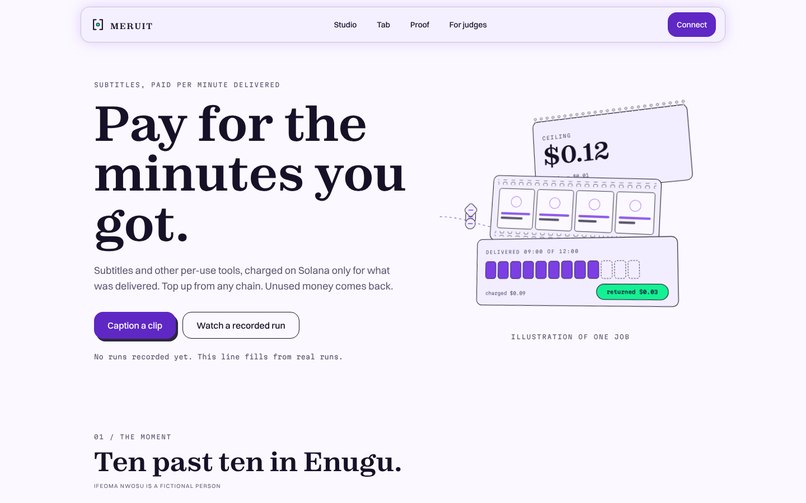
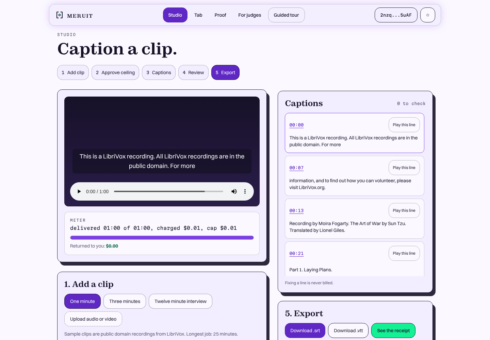
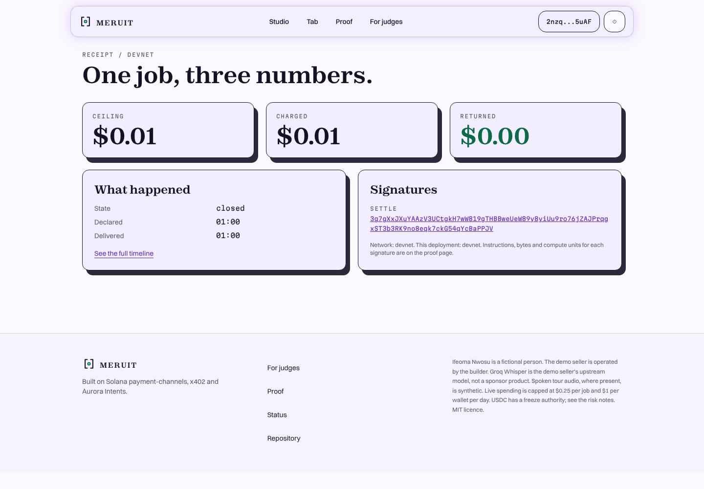
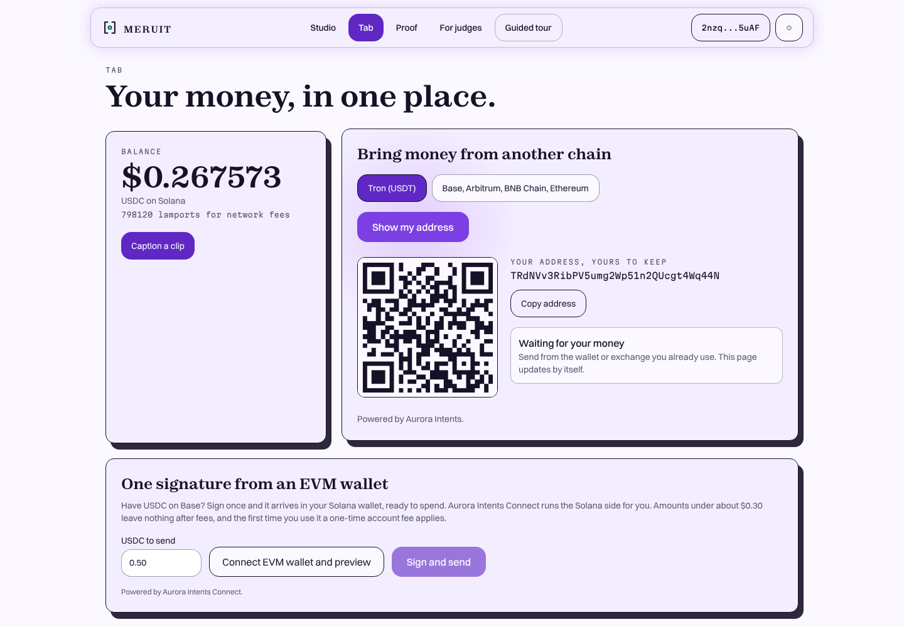
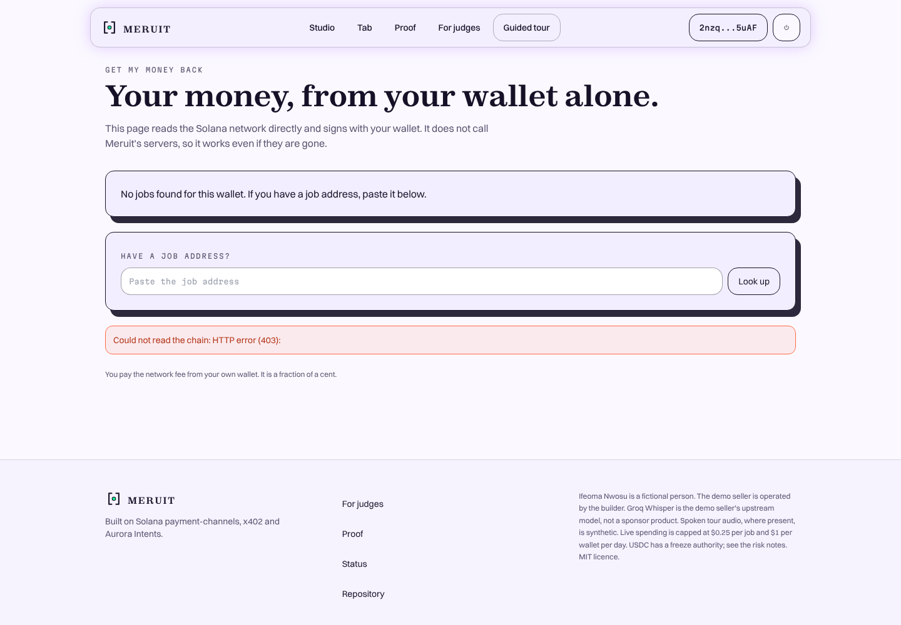
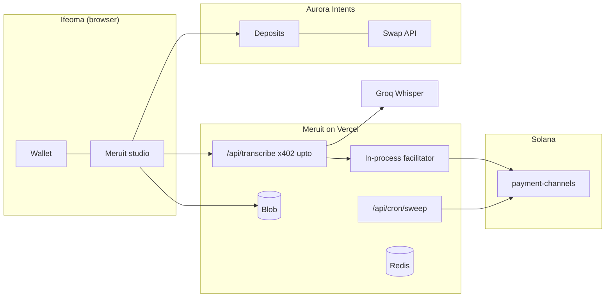
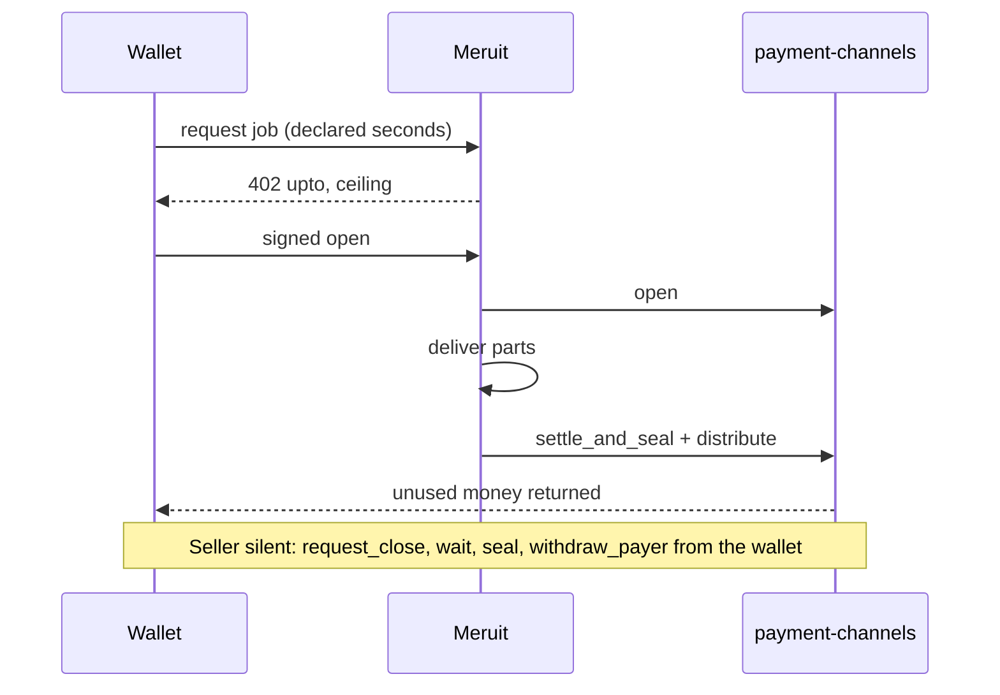

<p align="center"></p>

# MERUIT

[](https://meruit-delta.vercel.app) [](https://github.com/0xkinno/meruit/actions/workflows/ci.yml) [](#licence)

**Pay for the minutes you got: subtitles charged on Solana only for what was delivered, topped up from any chain.**



Ifeoma Nwosu, a freelance subtitler in Enugu, has a 12 minute interview due at 08:00 and a card that foreign billing rejects. She approves one ceiling per job in her own wallet, gets captions over her video, and is charged only for the minutes delivered. The rest returns in the same settlement, and she can take it back from her wallet alone if Meruit disappears.

> **Status, plainly.** The paid flow has run for real on Solana mainnet and devnet, with signatures in [FINDINGS.md](FINDINGS.md): a 12 minute job, the partial-delivery refund, and the buyer taking money back alone after the seller process was killed. The deployed site cannot run jobs yet because its server secrets and Redis are not set on Vercel. See [PROGRESS.md](PROGRESS.md).

| | |
|---|---|
| Live app | https://meruit-delta.vercel.app (pages live; paid jobs need the Vercel secrets, see ENV_SETUP.md) |
| For judges | [/judge](app/judge/page.tsx), [JUDGE.md](JUDGE.md) |
| Demo video | not recorded yet |
| Slides | [DECK.md](DECK.md), not rendered yet |
| Repo | https://github.com/0xkinno/meruit |
| Tracks | Best Consumer App on Solana; Best Use of x402 on Solana; Aurora Intents: Bring any-chain liquidity to Solana |
| Reality rung | mainnet with capped funds, including a job through the deployed site. Through Phantom in the browser: not yet |

| Studio with captions | Receipt | Tab with a deposit address | Get my money back |
|---|---|---|---|
|  |  |  |  |

The Studio and receipt are from a real devnet job; the Tab shows a real Tron deposit address issued by Aurora for the test wallet.

## The problem
It is 22:10 in Enugu. A client in Berlin sent an interview due at 08:00. The transcription tool wants a monthly card subscription for a job she does twice a month. Her naira card is declined for international web payments. She holds USDT on Tron.

The sources for this scene are listed in [MOMENT.md](MOMENT.md). Two of seven links could not be checked automatically and no statistic from them is used in the app. The founder note awaits approval.

## The solution
1. She tops up from the chain she already uses, to an address that is hers.
2. She approves one ceiling per job; the wallet signs exactly the amount shown.
3. Captions are made in 60 second parts; failed parts are not delivered and not charged.
4. The seller settles the real amount; the unused part returns in the same settlement.
5. She downloads `.srt` or `.vtt`. Fixing a line is never billed.

Her role: she approves the ceiling, listens to lines marked "check", and decides when to take money out. If Meruit goes quiet, her wallet runs request close, wait, seal, withdraw.

## Explore in 2 minutes
1. `npm install && npm test` (43 tests).
2. `npm run dev`, open `/`, `/proof`, `/status`.
3. `npx tsx scripts/run-job.ts --clip hero --dry` shows the real 402 challenge: `upto`, amount `120000` for 12 minutes.
4. `/rescue` renders and reads the network with every `/api` route blocked.

## Architecture


One job:
```
wallet            Meruit seller                     Solana payment-channels
GET/POST  ----->  402 upto, amount = ceiling
sign open ----->  verify, broadcast open ---------> open: escrow ceiling
                  transcribe parts, count delivered
                  charge = floor(delivered * rate)
captions  <-----  settle override ----------------> settle_and_seal + distribute
```

## Product flow


## Where the money goes
Real signatures from [`runs/tx/`](runs/tx) (bytes of the 1,232 limit, compute units). Full table with every row in [FINDINGS.md](FINDINGS.md).

| Path | Network | Instructions | Bytes | Compute units | Signature |
|---|---|---|---|---|---|
| Open | mainnet | open, memo | 755 | 39,840 | `2kVkHAAq...` |
| Settle $0.12, distribute | mainnet | Ed25519 check, settleAndSeal, distribute | 800 | 17,326 | `5Gxz1E5T...` |
| Settle $0.09 and return $0.03 (B1) | mainnet | same | 800 | not recorded | `hoTcdYTp...` |
| Buyer asks to close (B2) | mainnet | requestClose | not recorded | 271 | `5ytoGRdu...` |
| Buyer takes money back (B2) | mainnet | withdrawPayer | not recorded | 6,680 | `34KBXANT...` |
| Fee payer closes a sealed channel | mainnet | distribute | 561 | 15,901 | `2JPUDf1P...` |
| Reclaim rent for two channels | mainnet | reclaim x2 | 264 | 634 | `2UUKHjSq...` |

Reality rung: mainnet with capped funds (public cap $0.25 per job). Rent float per job is about 0.00197 SOL and was returned in full (B8).

## How Solana powers it
payment-channels (`CHNLx...`, live on mainnet and devnet per [PLATFORM_PROBE.md](PLATFORM_PROBE.md)) holds the ceiling in escrow. Instructions used through the SDK: `open`, `settle_and_seal`, `distribute`; by the buyer: `request_close`, `seal`, `withdraw_payer`; by the sweeper: seal and `reclaim` through the SDK's rent cleanup. Salt grinding to bump 255 is implemented ([lib/channels/salt.ts](lib/channels/salt.ts)); its compute-unit saving is not yet measured.

## x402 specifically
Scheme `upto` on Solana, self-facilitated, because the hosted x402.org facilitator lists Solana `exact` only. Headers: `PAYMENT-REQUIRED`, `PAYMENT-SIGNATURE`, `PAYMENT-RESPONSE`. The ceiling comes from the declared job length through a per-request `price` function. Failure handling: see the table below.

## Aurora Intents specifically
- **Deposits:** persistent deposit addresses for Tron and EVM to Solana USDC are issued on our key (shown on the Tab page). No live deposit through that address has been made yet.
- **Swap API:** live on mainnet. Exit Solana USDC to Base USDC in 1.6 minutes; a short deposit ended `INCOMPLETE_DEPOSIT` then `REFUNDED` after 8.0 minutes (B6).
- **Intents Connect:** live on mainnet. One signature on Base moved 0.497448 USDC and, 1.77 minutes later, 0.11755 USDC arrived in the buyer's Solana wallet through a Solana transaction that Aurora's intermediary ran (create the buyer's account if missing, then a checked USDC transfer). Origin `0xbaae0e95...`, Solana `3DGAaHQr...`. The API is open (no access request needed); bridge-in only needs the Aurora key in `x-api-key`, which the server adds. The Tab page has a card for it. About 0.38 USDC of the 0.497 went to fees, including a one-time charge for creating the wallet's intermediary token account; later runs skip that.
- **Confidential Intents:** a `confidentiality: basic` quote is accepted on our key; the Tab toggle stays hidden until a live confidential top-up has been recorded.
- Every Aurora status has its own screen ([lib/aurora/status.ts](lib/aurora/status.ts)).

## What it will not do
- Charge above the ceiling ([lib/billing/meter.ts](lib/billing/meter.ts)).
- Start a job above $0.25 or 25 minutes.
- Show a bridge word on a funding screen (tested in `tests/unit/aurora.test.ts`).
- Claim a sponsor product it does not call ([SDK_SURFACE.md](SDK_SURFACE.md)).

## Failed payments and failed deliveries
| What fails | What happens | Where |
|---|---|---|
| Wallet rejects | no channel, no charge | `components/Studio.tsx` |
| Verification fails | 402, nothing moves | `lib/x402/server.ts` |
| Upstream fails on parts | not delivered, not charged | `app/api/transcribe/route.ts` |
| Seller silent | buyer closes, waits, seals, withdraws | `lib/channels/escape.ts` |
| Stale slot | program refuses (`2003`) | not yet run (B4) |
| Overcharge attempt | refused (who refuses is B5) | not yet run |
| Short deposit | own screen, returned to sender | `lib/aurora/status.ts` |

## Measured
From [`docs/FACTS.json`](docs/FACTS.json), written by `scripts/facts.ts` from `runs/` (27 jobs: 23 devnet, 4 mainnet).
- Overcharges: **0** of 27. Undercharges in the wild set: **0**.
- Wild set: 19 of 20 pre-listed clips completed, on devnet only; one clip could not be decoded and is reported as a miss. Clips are about 93 seconds, not the 120 the list says (addendum in [`data/wild/SOURCES.md`](data/wild/SOURCES.md)).
- Cues marked "check": 0.0%. The threshold never fired on clean audiobook speech, so it is untested on hard audio.
- Both error directions: money taken for undelivered seconds is 0 in every run. Delivered seconds not charged: none observed.
- Forced exit: B2 completed on mainnet in 915 s (production delay) and on devnet in 70 s (shortened delay), zero loss.
- Same 12 minute clip with 3 of 12 parts failing (B1): $0.09 charged on both networks. An `exact` prepay of the ceiling would have cost $0.12 for the same 9 minutes ([`/proof`](app/proof/page.tsx), computed from the meter code).
- Aurora: live exit Solana to Base in 1.6 minutes; short deposit refunded after 8.0 minutes with a refund fee of about 20% of the amount (B6).
- B3: the same signed payment sent twice was refused the second time with `invalid_upto_svm_channel_already_open`, under a different job id so our own job guard was not the cause.
- B9: the same `open` instruction costs **31,565** compute units with a ground salt and **55,565** without (devnet, one pair), more than the 13,500 the docs' model predicts.
- Browser run on devnet with a test wallet: approval dialog, signature, captions, `.srt`, receipt, and both reject paths. The signature header carried the same amount the dialog showed.
- B7: one Base to Solana point so far (1.77 minutes, about 266 slots, none above the 1,500-slot window). One point is not a distribution; Tron is unmeasured.
- Not measured: cost per transcribed minute.

## What we learned
Two findings about the payment layer: a handler error is refunded automatically by the x402 server, but a refused settlement override leaves the deposit escrowed until the buyer or a sweeper closes it, so the buyer's escape hatch and the sweeper both matter. And a payment-channel `open` is valid for only 1,500 slots (B4 confirms the refusal), so it must not be pre-signed inside a cross-chain execution: bridge first, open after arrival. That second point is a design rule from the documentation; the bridge latency that would break it (B7) has not been measured. Details are in [FINDINGS.md](FINDINGS.md) and [FRICTION_REPORT.md](FRICTION_REPORT.md).

## Risk
See [RISK.md](RISK.md). USDC has a freeze authority on both networks (checked), so a frozen escrow could block a refund until thawed. That is the asset's own risk.

## What is live, substituted, designed
| Tier | Items |
|---|---|
| Live (has run against the real service) | self-facilitated `upto` on mainnet (also through the deployed site) and devnet; buyer escape hatch; rent reclaim and distribute; the sweeper on durable Redis; Groq transcription; Aurora token list, persistent addresses, quotes, live exit, refund case and an Intents Connect bridge-in |
| Code written, not yet run | the paid flow through Phantom (it ran in a browser on devnet with a test wallet, and by script through the deployed site on mainnet); the scheduled sweeper (run by hand once); a deposit through a persistent address from Tron or Base; the Connect card in a real MetaMask; confidential top-up |
| Substituted | in-memory store for local runs only, reported by `/api/status`; the demo payout wallet is a test key until `MERUIT_PAY_TO` is set to a real wallet |
| Designed | judge pocket, `batch-settlement` (not used) |

## Judging criteria map
| Track | Criterion | Where |
|---|---|---|
| Consumer | Clear user need and potential for adoption | MOMENT.md, /sell |
| Consumer | Ease of use, including onboarding | wallet connect, sample clip preloaded |
| Consumer | Technical execution and meaningful use of Solana | payment-channels, escape hatch |
| Consumer | A working end-to-end experience | built; not yet run paid |
| x402 | Meaningful integration of both x402 and Solana | self-facilitated `upto` |
| x402 | Reliability of the payment-to-access flow | job state machine, idempotent job id |
| x402 | A compelling use case beyond a basic integration demo | partial-delivery refunds, escape hatch |
| x402 | Clear documentation and sensible handling of failed payments | table above |
| Aurora | Working integration, demoed live | code written; live demo pending |
| Aurora | Removes a real cross-chain friction point | Tron USDT to Solana USDC |
| Aurora | Correct settlement and refund handling | status screens, refund address always set |
| Aurora | Clean UX that hides cross-chain complexity | one address per chain, plain words |

## Run it
```bash
npm install
npm run keys        # writes .env.local with fresh wallets; prints public keys only
npm run dev
```
Where each key goes is in [ENV_SETUP.md](ENV_SETUP.md); `.env.example` stays blank. For local runs without Redis set `MERUIT_STORE=memory`. `NEXT_PUBLIC_NETWORK=devnet` selects devnet; it is read at build time.

## Docs index
[ENV_SETUP.md](ENV_SETUP.md), [PROGRESS.md](PROGRESS.md), [MILESTONES.md](MILESTONES.md), [EVIDENCE.md](EVIDENCE.md), [PROOF.md](PROOF.md), [FINDINGS.md](FINDINGS.md), [FRICTION_REPORT.md](FRICTION_REPORT.md), [SDK_SURFACE.md](SDK_SURFACE.md), [RISK.md](RISK.md), [DESIGN.md](DESIGN.md), [JUDGE.md](JUDGE.md).

## Disclosures
AI assistants were used to write code and documents. The demo seller is operated by the builder. Groq Whisper is the demo seller's upstream model, not a sponsor product. No synthetic tour voice is shipped.

## Licence
MIT.
