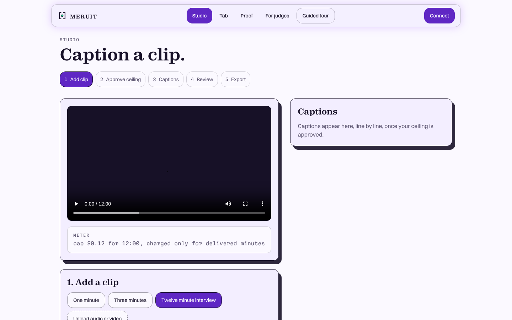
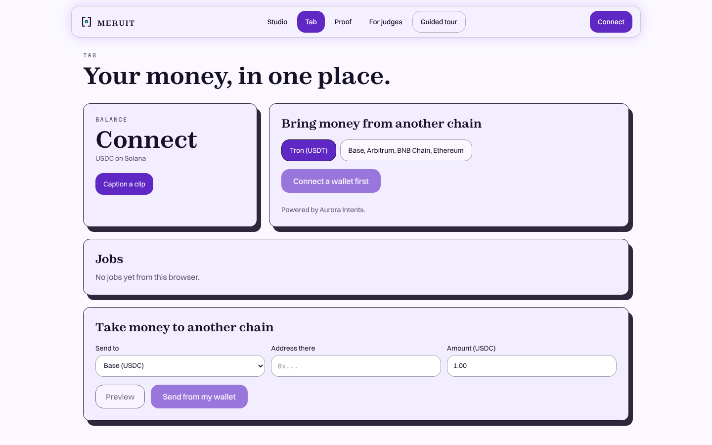
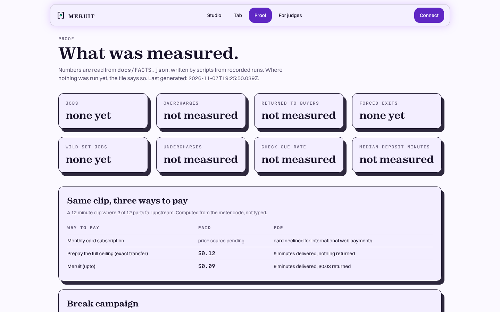
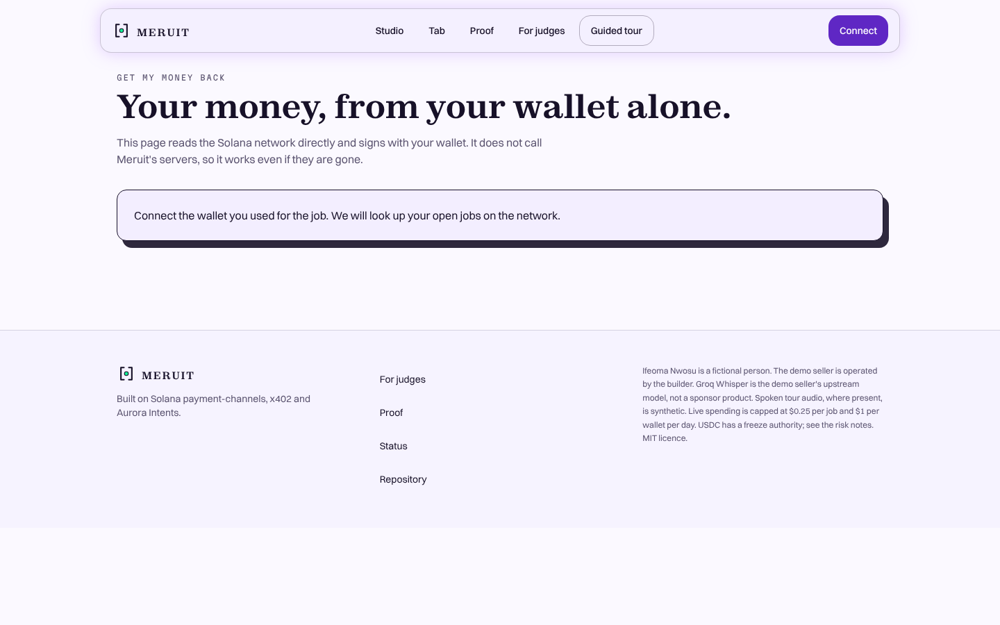
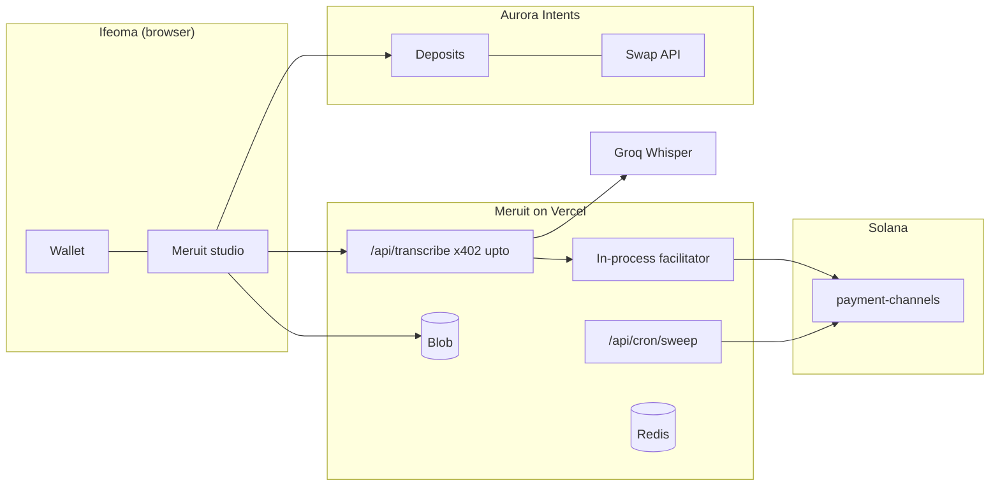
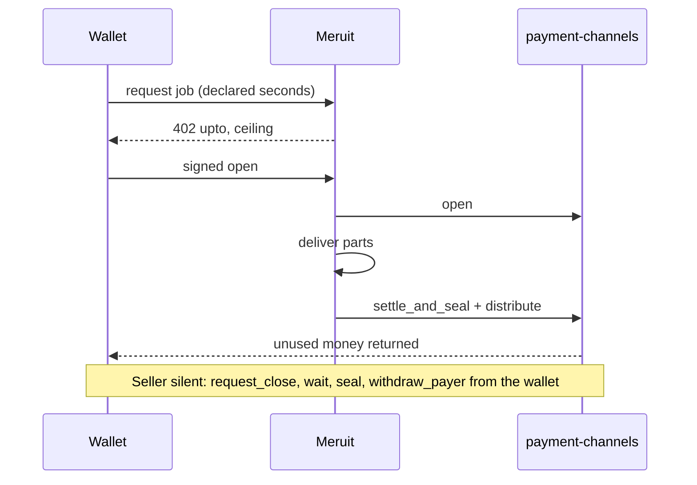

<p align="center"></p>

# MERUIT

[](https://meruit.vercel.app) [](https://github.com/0xkinno/meruit/actions/workflows/ci.yml) [](#licence)

**Pay for the minutes you got: subtitles charged on Solana only for what was delivered, topped up from any chain.**


Ifeoma Nwosu (a fictional freelance subtitler in Enugu) has a 12 minute interview due at 08:00 and a card that foreign billing rejects. She approves one ceiling per job in her own wallet, gets captions over her video, and is charged only for the minutes delivered. The rest returns in the same settlement, and she can take it back from her wallet alone if Meruit disappears.

> **Status, plainly.** The code, UI and checks below are built and tested. No paid job has run on chain yet: the wallets are unfunded and Groq, Aurora, Redis and Blob are not configured. Every "measured" section therefore says so. See [PROGRESS.md](PROGRESS.md).

| | |
|---|---|
| Live app | https://meruit.vercel.app (after first deploy) |
| For judges | [/judge](app/judge/page.tsx), [JUDGE.md](JUDGE.md) |
| Demo video | not recorded yet |
| Slides | [DECK.md](DECK.md), not rendered yet |
| Repo | https://github.com/0xkinno/meruit |
| Tracks | Best Consumer App on Solana; Best Use of x402 on Solana; Aurora Intents: Bring any-chain liquidity to Solana |
| Reality rung | code and local 402 only. Mainnet with capped funds is the target, not yet reached |

| Studio | Tab | Proof | Get my money back |
|---|---|---|---|
|  |  |  |  |

These are page layouts with no job data, because no job has run.

## The problem
It is 22:10 in Enugu. A client in Berlin sent an interview due at 08:00. The transcription tool wants a monthly card subscription for a job she does twice a month. Her naira card is declined for international web payments. She holds USDT on Tron.

The sources for this scene are listed in [MOMENT.md](MOMENT.md). Two of seven links could not be checked automatically and no statistic from them is used in the app. The founder note awaits approval.

## The solution
1. She tops up from the chain she already uses, to an address that is hers.
2. She approves one ceiling per job; the wallet signs exactly the amount shown.
3. Captions are made in 60 second parts; failed parts are not delivered and not charged.
4. The seller settles the real amount; the unused part returns in the same settlement.
5. She downloads `.srt` or `.vtt`. Fixing a line is never billed.

Her role: she approves the ceiling, listens to lines marked "check", and decides when to take money out. If Meruit goes quiet, her wallet runs request close, wait, seal, withdraw.

## Explore in 2 minutes
1. `npm install && npm test` (43 tests).
2. `npm run dev`, open `/`, `/proof`, `/status`.
3. `npx tsx scripts/run-job.ts --clip hero --dry` shows the real 402 challenge: `upto`, amount `120000` for 12 minutes.
4. `/rescue` renders and reads the network with every `/api` route blocked.

## Architecture


One job:
```
wallet            Meruit seller                     Solana payment-channels
GET/POST  ----->  402 upto, amount = ceiling
sign open ----->  verify, broadcast open ---------> open: escrow ceiling
                  transcribe parts, count delivered
                  charge = floor(delivered * rate)
captions  <-----  settle override ----------------> settle_and_seal + distribute
```

## Product flow


## Where the money goes
No signatures are recorded yet. When runs exist this table is filled by `scripts/record-tx.ts` (instructions, bytes of 1,232, compute units, signature). See `runs/tx/` and [PROOF.md](PROOF.md).

## How Solana powers it
payment-channels (`CHNLx...`, live on mainnet and devnet per [PLATFORM_PROBE.md](PLATFORM_PROBE.md)) holds the ceiling in escrow. Instructions used through the SDK: `open`, `settle_and_seal`, `distribute`; by the buyer: `request_close`, `seal`, `withdraw_payer`; by the sweeper: seal and `reclaim` through the SDK's rent cleanup. Salt grinding to bump 255 is implemented ([lib/channels/salt.ts](lib/channels/salt.ts)); its compute-unit saving is not yet measured.

## x402 specifically
Scheme `upto` on Solana, self-facilitated, because the hosted x402.org facilitator lists Solana `exact` only. Headers: `PAYMENT-REQUIRED`, `PAYMENT-SIGNATURE`, `PAYMENT-RESPONSE`. The ceiling comes from the declared job length through a per-request `price` function. Failure handling: see the table below.

## Aurora Intents specifically
Deposits (persistent address, with a labelled single-use fallback because persistent creation is limited to approved organisations), Swap API for the exit, a `confidentiality` toggle hidden until probed, and Intents Connect labelled **designed, not live**. Every Aurora status has its own screen ([lib/aurora/status.ts](lib/aurora/status.ts)). None of this has run against the live API yet.

## What it will not do
- Charge above the ceiling ([lib/billing/meter.ts](lib/billing/meter.ts)).
- Start a job above $0.25 or 25 minutes.
- Show a bridge word on a funding screen (tested in `tests/unit/aurora.test.ts`).
- Claim a sponsor product it does not call ([SDK_SURFACE.md](SDK_SURFACE.md)).

## Failed payments and failed deliveries
| What fails | What happens | Where |
|---|---|---|
| Wallet rejects | no channel, no charge | `components/Studio.tsx` |
| Verification fails | 402, nothing moves | `lib/x402/server.ts` |
| Upstream fails on parts | not delivered, not charged | `app/api/transcribe/route.ts` |
| Seller silent | buyer closes, waits, seals, withdraws | `lib/channels/escape.ts` |
| Stale slot | program refuses (`2003`) | not yet run (B4) |
| Overcharge attempt | refused (who refuses is B5) | not yet run |
| Short deposit | own screen, returned to sender | `lib/aurora/status.ts` |

## Measured
Nothing yet. `docs/FACTS.json` records 0 jobs. Wild set, both error directions, counterfactual with real runs, forced exit and cost per minute are pending runs. The counterfactual on `/proof` is computed from the meter code, not from a run.

## What we learned
One finding so far, from documentation and not yet measured: a payment-channel `open` is valid for 1,500 slots, so it must not be pre-signed inside a cross-chain execution; bridge first, open after arrival. Details and the pre-registered questions are in [FINDINGS.md](FINDINGS.md) and [FRICTION_REPORT.md](FRICTION_REPORT.md).

## Risk
See [RISK.md](RISK.md). USDC has a freeze authority on both networks (checked), so a frozen escrow could block a refund until thawed. That is the asset's own risk.

## What is live, substituted, designed
| Tier | Items |
|---|---|
| Live (has run against the real service) | payment-channels program presence on both networks; the `upto` 402 challenge locally; x402.org `/supported` |
| Code written, not yet run | self-facilitated settlement, escape hatch, sweeper, Groq transcription, Blob upload, Aurora Deposits and Swap API, salt grinding |
| Substituted | single-use Aurora address when persistent creation is refused; in-memory store only for local tests, reported by `/api/status` |
| Designed | Intents Connect, confidential top-up toggle, judge pocket, `batch-settlement` (not used) |

## Judging criteria map
| Track | Criterion | Where |
|---|---|---|
| Consumer | Clear user need and potential for adoption | MOMENT.md, /sell |
| Consumer | Ease of use, including onboarding | wallet connect, sample clip preloaded |
| Consumer | Technical execution and meaningful use of Solana | payment-channels, escape hatch |
| Consumer | A working end-to-end experience | built; not yet run paid |
| x402 | Meaningful integration of both x402 and Solana | self-facilitated `upto` |
| x402 | Reliability of the payment-to-access flow | job state machine, idempotent job id |
| x402 | A compelling use case beyond a basic integration demo | partial-delivery refunds, escape hatch |
| x402 | Clear documentation and sensible handling of failed payments | table above |
| Aurora | Working integration, demoed live | code written; live demo pending |
| Aurora | Removes a real cross-chain friction point | Tron USDT to Solana USDC |
| Aurora | Correct settlement and refund handling | status screens, refund address always set |
| Aurora | Clean UX that hides cross-chain complexity | one address per chain, plain words |

## Run it
```bash
npm install
npm run keys        # writes .env.local with fresh wallets; prints public keys only
npm run dev
```
Set the keys in `.env.example`. For local runs without Redis set `MERUIT_STORE=memory`. `NEXT_PUBLIC_NETWORK=devnet` selects devnet; it is read at build time.

## Docs index
[TASK.md](TASK.md), [PROGRESS.md](PROGRESS.md), [MILESTONES.md](MILESTONES.md), [EVIDENCE.md](EVIDENCE.md), [PROOF.md](PROOF.md), [FINDINGS.md](FINDINGS.md), [FRICTION_REPORT.md](FRICTION_REPORT.md), [SDK_SURFACE.md](SDK_SURFACE.md), [RISK.md](RISK.md), [DESIGN.md](DESIGN.md), [JUDGE.md](JUDGE.md).

## Disclosures
AI assistants were used to write code and documents. Ifeoma Nwosu is fictional. The demo seller is operated by the builder. Groq Whisper is the demo seller's upstream model, not a sponsor product. No synthetic tour voice is shipped.

## Licence
MIT.
